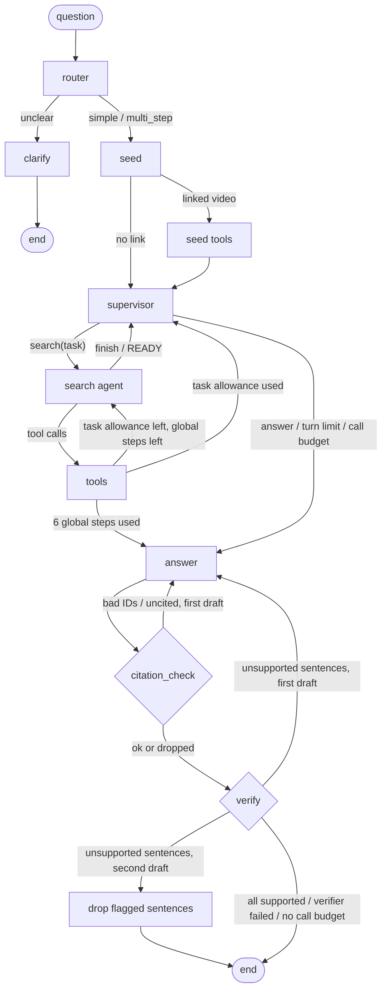

# Plan: a minimal multi-agent variant (supervisor + search agent + verification agent)

Written 2026-10-13, before any code. Nothing here is built yet. The goal is one new architecture, `multi`, next to the current agent, `single`. The plan also covers an eval that compares the two fairly: same queries, same judge, same models, same token caps and the same request budget.

The current agent (fixed v2) stays the reference. It must behave exactly as it does today: same prompts, same node order, same LLM calls for the same inputs. Everything below is either new code or a refactor that a test pins down.

---

## 1. What the current agent does (the starting point)

`atlandex_agent/graph.py`, one LangGraph `StateGraph`:

```
router -> clarify -> END
router -> seed -> (tools) -> agent <-> tools -> answer -> citation_check -> (answer once more) -> END
```

- **router**: JSON route (`simple` / `multi_step` / `unclear`). Two attempts, then it falls back to `multi_step`.
- **seed**: runs `search_video` on YouTube links in the question (up to 3). Each counts as a step.
- **agent loop**: one LLM turn returns tool calls or `finish`/`READY`. At most `max_tool_steps = 6` tool calls. Each turn is capped by `Settings.agent_cap_for(model)` (large 1500, small 600). The context is rebuilt every turn with `bound_evidence(..., 12000)`.
- **answer**: writes from the retrieved segments only. The default cap is `max_tokens = 1500`. An empty answer is retried once with `answer_retry_max_tokens = 4000`.
- **citation_check**: deterministic. Bad IDs or uncited claims get one rewrite, then those sentences are dropped. An empty answer raises `EmptyAnswerError`, so the run fails.

**Most LLM calls one run can make: 13.** Router 2, agent turns 7 (6 steps plus one nudge turn), answer 2 (first try plus the empty retry), and 2 more for one citation rewrite (with its own empty retry). Observed in fixed v2: a mean of 4.7 (large) and 4.25 (small) calls per run, max 9 (`eval/results/20261012-fixed-v2/trajectory.json`). Section 5 uses this number.

---

## 2. Graph structure of `multi`

### 2.1 Roles

| role | LLM? | what it does | reuses |
|---|---|---|---|
| **router** | yes | unchanged | `router` node, `ROUTER_SYSTEM` |
| **clarify** | yes | unchanged | `clarify` node |
| **seed** | no | unchanged: reads linked videos first | `seed` node |
| **supervisor** | yes (new) | Looks at the question, route and evidence so far. Then either delegates **one search task** (a short sub-question, for example "what does Andreessen say about X") or decides the evidence is enough and hands over to the answer step. Does not call tools. | new `SUPERVISOR_SYSTEM` |
| **search agent** | yes | The current agent loop, scoped to the supervisor's task. It calls MCP tools until it calls `finish`, uses up its per-task step allowance, or hits the global step limit, then returns to the supervisor. | `agent` + `tools` nodes, `AGENT_SYSTEM` unchanged; the user message gets one extra `Task:` line |
| **answer** | yes | unchanged (the writer) | `answer` node, `ANSWER_SYSTEM` |
| **citation_check** | no | unchanged (deterministic) | `citation_check` node |
| **verification agent** | yes (new) | Gets each answer sentence with the text of the segments it cites, and returns the indices of sentences those segments do not support. Flagged sentences get one rewrite, or are dropped if the rewrite slot is already used. | new `VERIFY_SYSTEM`, new `atlandex_agent/verification.py` |

### 2.2 Edges



Rules that keep this small and bounded:

1. **Supervisor turns:** at most `max_supervisor_turns = 3` (for example search, search, answer). On the third turn the only option is `answer`. An unparseable supervisor reply falls back deterministically: `search` with the full question as the task if nothing has been retrieved yet, otherwise `answer`. The fallback is recorded in `notes`.
2. **Search steps:** the global limit stays `max_tool_steps = 6`, shared by seed and every search task. Each task gets at most `search_steps_per_task = 3` steps (never more than the global steps left). The step-counting, duplicate-call and nudge logic is the existing `run_tools`/`agent` code. The nudge ("you must call a tool first") applies once per run, as now.
3. **No more than two answer drafts, as in `single`.** The verifier's rewrite uses the same slot as the citation-check rewrite (`answer_attempts < 2`). If citation_check has already asked for a rewrite, the verifier does not ask again: it drops the sentences it flags. So `answer` is called for at most two drafts (plus their empty-answer retries), exactly the same limit as `single`.
4. **Verification rounds:** at most 2 (the first draft, then the rewrite). After a rewrite, citation_check runs again before verify, so a rewrite that adds bad IDs is still caught deterministically.
5. **Fail-open verifier:** if the verify reply is empty or unparseable, nothing is dropped. This is noted (`verify.failed = true`) and counted. A verifier failure must never delete content; that would bias the hallucination rate down for the wrong reason.
6. **The fixed "no coverage" reply** (no segments retrieved) skips verification, as it skips citation_check's claim check today.
7. **Out of scope for the minimal version:** the verifier cannot send the run back to the supervisor for more searching ("gap re-plan"). That would break rule 3 (more drafts than `single`) and complicate the call budget. Listed under follow-ups (section 9).

### 2.3 State additions

`State` gets new optional keys, all defaulting to absent, so `single` never sees them:

- `arch`: `"single"` | `"multi"`
- `task`: the current search task text; `task_steps_start`: `len(tool_log)` when the task began
- `supervisor_turns`: a list of `{action, task, completion_tokens, finish_reason, cap, fallback}`
- `verify`: `{rounds, flagged_first, flagged_second, dropped_unverified, failed, skipped_budget}`

### 2.4 The verification agent, in detail

- **Input**, built by `verification.build_verify_input(sentences, segments)` in `atlandex_agent/verification.py`: numbered answer sentences, each with the text of the segments it cites. It is written separately from `eval/judge.py`'s `build_judge_input`. The agent package must not import from `eval/` (today's dependency runs only the other way), and the verifier should not copy the judge's format and rubric word for word (see 6.5).
- **Output:** `{"unsupported": [<indices>], "reasons": {"<i>": "<= 12 words"}}`. Parsing is tolerant, through the existing `parse_json_object`. An out-of-range index is ignored.
- **Sentences:** split with `citations.answer_sentences`, the same splitter `drop_uncited` uses, so a dropped sentence is exactly the sentence that was flagged. Sentences with no citation never reach the verifier: citation_check has already handled them, and non-claims ("the segments do not cover X") are left alone.
- **Rewrite feedback:** this reuses the `feedback` state key: "These sentences are not supported by the segments they cite: … Rewrite them so they say only what the cited segment says, or delete them."
- **Drop:** a new pure function, `citations.drop_sentences(answer, indices)`. It keeps line breaks, like `drop_uncited`. An answer with nothing left becomes `NO_COVERAGE`, as today.

### 2.5 Models and caps per role (the "same models, same token caps" rule)

**Every LLM role in `multi` runs on the agent model under test.** In a `small` run the supervisor, search agent, answer and verifier are all `laguna`; in a `large` run they are all `nemotron`. No mixing, for example a large supervisor over a small searcher: that would be a different experiment (section 9).

| role | `max_tokens` | source |
|---|---|---|
| router, clarify | 1500 | `settings.max_tokens` (unchanged) |
| search agent turn | 1500 large / 600 small | `settings.agent_cap_for(model)` (unchanged) |
| supervisor turn | 1500 large / 600 small | `settings.agent_cap_for(model)`: like an agent turn, it is a short control decision |
| answer | 1500, empty retry 4000 | unchanged |
| verify | 1500 | `settings.verify_max_tokens`, default `None` → `settings.max_tokens` |
| judge (eval) | 4000 | `JUDGE_MAX_TOKENS` (unchanged, same for both arms) |

**Known risk:** the large model is a reasoning model, and the judge at 1500 tokens returned empty replies (see DECISIONS.md "Judge coverage"). The verify role could do the same. The smoke run (7.2) measures the empty and unparseable verify rate. **The rule, fixed now:** if more than 20% of large-model verify calls in the smoke run are empty or cut off, `verify_max_tokens` goes to 4000 before the full run, and this is written into DECISIONS.md. The decision is made from the smoke run, never from full-run metrics.

---

## 3. Files to change

### Agent package

| file | change |
|---|---|
| `atlandex_agent/graph.py` | **Refactor with no behaviour change:** move the node functions out of `build_graph` into `make_nodes(llm, tools, settings, budget) -> dict[str, callable]`. `build_graph` wires `single` from them exactly as now. The `agent` node gets an optional `task` parameter: with `state["task"]` set, it adds `Task: …` and `Steps left for this task: n` to the user message. Without a task, the message is byte-for-byte unchanged. `run_agent` gets `arch: str = "single"`; it builds `single` or `multi`, wraps the LLM in a `CallBudget` (section 5), and adds `arch`, `supervisor_turns`, `verify`, `llm_calls_cap` and `llm_calls_used` to the result. `NO_COVERAGE`, `EmptyAnswerError`, `parse_json_object` and `run_agent` stay importable from `graph`, because tests and `eval/judge.py` import them. |
| `atlandex_agent/multi_agent.py` (new) | `build_multi_agent_graph(llm, tools, settings, budget)`: the `supervisor`, `search_agent` (the shared agent node with a task), `verify` and `drop_unverified` nodes, the routing functions, and the wiring in 2.2. About 150 lines. |
| `atlandex_agent/verification.py` (new) | Pure functions: `build_verify_input`, `parse_verify_reply`, `verify_feedback`. No LLM, no I/O. |
| `atlandex_agent/citations.py` | Add `drop_sentences(answer, indices)` (pure, keeps lines). |
| `atlandex_agent/prompts.py` | Add `SUPERVISOR_SYSTEM` and `VERIFY_SYSTEM`. **`ROUTER_SYSTEM`, `AGENT_SYSTEM`, `ANSWER_SYSTEM` and `CLARIFY_SYSTEM` are not edited.** The search agent's task is passed in the user message, not by editing `AGENT_SYSTEM`, so both arms search with the same system prompt. |
| `atlandex_agent/config.py` | New settings, each with an env var: `arch = "single"` (`AGENT_ARCH`), `search_steps_per_task = 3`, `max_supervisor_turns = 3`, `verify_max_tokens: int \| None = None`, `max_llm_calls_per_run = 13` (`MAX_LLM_CALLS_PER_RUN`). Comments say why each value was picked. |
| `atlandex_agent/llm.py` | Add `OpenRouterClient.key_status()`: `GET /api/v1/key`, returns `{"daily_limit", "used_today", "remaining"}` for the free-request guard. It reuses the existing auth header and never logs the key. No change to `chat`. |
| `atlandex_agent/tracing.py` | `TraceInfo.arch`, sent as tag `arch:<x>` and root metadata. New node spans appear automatically through the LangGraph callback handler. |
| `atlandex_agent/cli.py` | `--arch single\|multi` (default from `Settings.arch`). `format_result` prints supervisor tasks and verify drops for `multi`. |

### Eval harness

| file | change |
|---|---|
| `eval/run.py` | `--arch single\|multi\|both` (default `single`, so today's commands do the same as before). Every record gets `arch`. With `both`, **the two arms run back to back for each (query, model)**, alternating which goes first (even index single first, odd multi first), so free-tier load and backend state hit both equally. The record key becomes `(id, model_alias, arch)` in `merge_records`, `--resume` and `kept`. New `--min-free-requests N` (default 60): before each query-run it checks `key_status()` and stops cleanly below N, as `stopped_early`, reusing the existing path. This replaces the separate guard process used for v1/v2. `summary.json` gains `by_arch: {arch: aggregate(...)}` when more than one arch is present, and a `run_config` block: git commit, dirty flag, model ids, judge model, every cap in 2.5, `max_tool_steps`, `max_llm_calls_per_run`, `search_steps_per_task`, `max_supervisor_turns`, `evidence_char_budget`, the cache flag, and SHA-256 hashes of each prompt string and of `judge_prompt.md`. `summary.md` gets one headline table per arch. |
| `eval/metrics.py` | `aggregate()` is unchanged, so old runs re-summarise identically. `summarize()` gains the columns needed to spot unfair gains: `llm_calls_mean`/`llm_calls_max` (agent calls, judge excluded), `http_attempts_total` (sum of `CallRecord.attempts`), `final_sentences_mean`, `no_coverage_answers`, `verify_dropped`, `verify_failed`, `verify_skipped_budget`, `supervisor_fallbacks`. New pure helpers for paired analysis: `discordant(pairs)` → `(a_only, b_only)` and `sign_test_p(a_only, b_only)` (exact two-sided binomial), plus `bootstrap_diff(per_query_a, per_query_b, n=2000, seed=0)` for the hallucination-rate difference, resampling queries rather than sentences. |
| `eval/summarize.py` | Rebuilds `by_arch` when records carry more than one arch. Records without `arch` are read as `single`. |
| `eval/compare.py` | `--baseline` and `--fixed` accept `DIR[:arch]`. Pairing stays on `(id, model_alias)` after filtering each side to its arch, so `R:single` vs `R:multi` pairs within one run. New `--name` sets the output file stem (default `comparison`), so one folder can hold several comparisons. Extra summary columns: LLM calls mean/max, segment and video hit, discordant segment-hit pairs with the sign-test p, final sentences per answer, no-coverage answers, route disagreements (same query, different route between arms). |
| `eval/trajectory.py` | `--run LABEL=DIR[:arch]`, same selector. |
| `eval/rejudge.py` | The sidecar key becomes `(id, model, arch)`, with `arch` defaulting to `single`, so the alternative-judge re-run (6.5) covers both arms without collisions. Old sidecars still load. |
| `eval/sample_for_labels.py` | `--arch` filter, so a reference-label sample can be drawn from the `multi` answers (optional step in 6.5). |

### Docs and housekeeping

- `README.md`: a "Multi-agent variant" section with the graph, the `--arch` flag and, after the run, a results section kept apart from fixed v2 in the same style as the existing ones.
- `DECISIONS.md`: a "Multi-agent comparison" section. The pre-registration (7.1) is written **before** the full run and committed. Results and anything that went wrong are added after.
- `.gitignore`: a `!eval/results/<run>/` line for the published comparison run only.
- `.env.example`: the new optional variables.

---

## 4. Tests (all offline, existing fakes)

`tests/fakes.py` needs no change: `FakeLLM` already serves replies per role, so `supervisor` and `verify` are just new queues. It gains one helper, `json_reply(obj)`.

### 4.1 `single` is unchanged (the most important test)

`tests/test_single_unchanged.py`:
- **Golden transcript.** For four scripted scenarios (simple with a link; multi-step without a link; citation retry then drop; empty answer then retry), record `llm.prompts` (role, messages), `llm.max_tokens`, `llm.tools_offered` and `tools.calls`, and compare them with fixtures in `tests/golden/single_*.json`. The fixtures are generated from **today's `main`, before the refactor**, and committed in the first PR. Any change to a `single` prompt, cap or call order fails this test.
- `run_agent` with no `arch` argument gives `arch == "single"`. A record without `arch` is read as `single` everywhere in `eval/`.

### 4.2 Call budget

`tests/test_call_budget.py`:
- **Worst case for `single`:** the router fails twice, the agent skips tools once (nudge), then makes 6 single-call turns. The answer is empty, then OK, then fails the citation check, then is empty again, then OK. That is exactly 13 calls, and `CallBudget` never refuses one. This test proves the cap of 13 never binds for `single`.
- **`multi` under the cap:** a scripted worst case (supervisor always says search, the search agent never finishes, verify flags everything) ends with `llm_calls_used <= 13`. It still ends with an answer (not an exception) and records `verify.skipped_budget` or a forced answer in `notes`.
- **`CallBudget` as a safety net:** a direct call over the cap raises `CallBudgetExceeded`, and `eval.run` counts that as a run error (`RUN_ERRORS`). Graph code must never let it happen; this test only checks the guard itself.

### 4.3 Multi-agent graph

`tests/test_multi_agent.py`:
- supervisor → search(task) → finish → supervisor → answer → verify (all supported) → END: the roles appear in that order, the task text is in the search agent's user message, and `AGENT_SYSTEM` is unchanged.
- The search agent returns to the supervisor once its per-task allowance (3) is used, even without `finish`.
- The global limit of 6 steps holds across several tasks and the seed. When it is reached, the next node is `answer`, not the supervisor.
- The supervisor turn limit: the third turn can only answer.
- An unparseable supervisor reply falls back to `search(question)` with no evidence and to `answer` with evidence, and is noted.
- The `unclear` route still goes only to clarify (no supervisor call).
- A linked video is seeded before the first supervisor turn and counts as a step.
- The supervisor and search turns get `agent_cap_for(model)`; verify gets `verify_max_tokens or max_tokens`. These are checked on `llm.max_tokens`, for both a large and a small model id.

### 4.4 Verification

`tests/test_verification.py`:
- `build_verify_input` shows the cited segment text and marks IDs that were not retrieved. Sentences with no citation are not sent.
- `parse_verify_reply` handles fences, `<think>` tags, out-of-range and duplicate indices, and an empty reply (returns `None`, never an empty list).
- With flagged sentences on the first draft: a rewrite with feedback naming them, then citation_check, then verify round 2. Sentences flagged again are dropped and recorded in `verify.dropped_unverified`.
- With flagged sentences after a citation-check rewrite: no third draft; they are dropped directly. `answer` was called at most twice (not counting empty retries).
- A verifier that fails (empty or unparseable reply) drops nothing, and `verify.failed` is set.
- Dropping everything gives `NO_COVERAGE`. The `NO_COVERAGE` answer is never sent to the verifier.
- `drop_sentences` keeps line breaks and leaves unflagged sentences byte-identical.

### 4.5 Eval harness

`tests/test_arch_eval.py`:
- `merge_records` and `--resume` key on `(id, model_alias, arch)`: re-running only the errored `multi` records keeps every finished `single` record.
- The `--arch both` order alternates per query: tested on a pure helper `run_order(rows, models, arches)` that returns the list of (row, model, arch) to run.
- `aggregate` on records without `arch` gives the same output as today: a snapshot of `eval/results/20261012-fixed-v2/summary.json`'s headline, recomputed from a small synthetic set.
- `summary.json` has `by_arch` and a `run_config` with prompt hashes, all caps and the git commit, and no absolute paths (extends `test_summary_command_has_no_absolute_paths`).
- `compare` with `DIR:single` vs `DIR:multi` pairs within one folder; only query-runs completed in both arms are paired; route disagreements are counted.
- `sign_test_p(0, 0) == 1.0`, `sign_test_p(5, 0)` gives the known value (0.0625). `bootstrap_diff` is deterministic with a seed.
- The free-request guard: a mock transport for `/api/v1/key` with `remaining < N` stops the run before the next query-run, sets `stopped_early`, and sends no chat request.
- The rejudge sidecar keys with arch: old sidecars without `arch` still merge.

CI (`.github/workflows/tests.yml`) needs no change: everything is offline.

---

## 5. Request budget, defined the same for both arms

"Same request budget" is applied at three levels, each equal for both arms:

1. **Per run, LLM calls: `max_llm_calls_per_run = 13`.** This is `single`'s structural maximum (section 1), so the cap never changes `single`'s behaviour (test 4.2) and `multi` can never use more calls than `single` is allowed. It is enforced by `CallBudget`, a thin wrapper around the bound LLM that counts the calls of this run. Nodes ask `budget.left()` before **optional** calls and degrade instead of failing:
   - The supervisor or search agent may start a new call only if `left() - RESERVE >= 1`, where `RESERVE = 5` (answer 2 + one rewrite 2 + one verify 1). Otherwise the run goes to `answer`, noted as `call budget: forced answer`.
   - verify runs only if `left() >= 1` after the answer path. Otherwise `verify.skipped_budget = true`.
   - The second verify round runs only if `left() >= 1`.

   This is a cap on **logical calls**. HTTP retries after 429/5xx (`CallRecord.attempts`) are provider noise. They do not count against the per-run cap, but they are reported (`http_attempts_total`) and do count for the daily guard below.
2. **Per run, tool steps: `max_tool_steps = 6`**, shared by seed and all search tasks, as in `single`.
3. **Per eval session, free requests:** one `OpenRouterClient` (one throttle, 20 requests per minute) is shared by both arms. The run stops when `/api/v1/key` reports fewer than `--min-free-requests` (60) left. Because the arms alternate per query, a stop cuts both arms at the same point. Pairing then uses only query-runs completed in both.

**This is "equal maximum budget", not "equal spend".** `multi` will use more calls on average (supervisor and verify). The comparison reports calls, tokens and latency next to the quality numbers, so a quality gain can be weighed against its cost. It is never presented as free.

**Estimate for the full comparison** (29 verified queries, `--include-review` off): `single` about 4.5 agent calls + 1.1 judge calls; `multi` about 8 + 1.1 (router 1, supervisor 2, search 2.5, answer 1.3, verify 1.3). That is about 15 requests per query per model, **about 435 per model**, before 429 retries. The small model needed retries on about 60% of calls in v1, so expect about 700 attempts for it. **That does not fit both models into one 1,000-request day.** Plan: day 1 the large model (both arms), day 2 the small model (both arms), each in its own results folder. The comparison is always within one model, and both arms of a model always run in the same session, so the split costs nothing in fairness.

---

## 6. Keeping the eval comparison fair

### 6.1 Same queries
- `eval/dataset.jsonl` unchanged. The headline is the 29 verified queries (22 `existing` + 7 verified `new_candidate`), selected by the existing `select()`. `--include-review` stays off for this comparison to save requests; the 3 unverified candidates are never in the headline anyway.
- Pairing on `(id, model_alias)`: only query-runs completed in **both** arms count. Runs that failed on a provider outage are shown in *runs ok/total*, as today.

### 6.2 Same judge
- Same model (`settings.model_large`), same `judge_prompt.md` (its hash is recorded in `run_config`), same `JUDGE_MAX_TOKENS = 4000`, same batched retry, same parsing. The judge sees only the final answer and the retrieved segments, never the arch.
- The judge runs inside the same `eval.run` session as the agent, for both arms. No arm is re-judged on its own unless the other is re-judged the same way.
- `metrics.py` rules are unchanged: unjudged sentences are never clean, the rate is on judged sentences, and the upper bound is shown.

### 6.3 Same models and token caps
- Same `MODEL_SMALL` / `MODEL_LARGE`, recorded in `run_config`. Every role of both arms runs on the agent model under test (2.5).
- The caps in 2.5 are the same for the shared roles. The new roles take existing values (`agent_cap_for`, `max_tokens`), not numbers tuned for `multi`. The only allowed exception is the pre-registered verify-cap rule in 2.5, decided from the smoke run.
- `temperature = 0` for both. `ALLOW_PAID=false`.

### 6.4 Same conditions at run time
- **A fresh `single` run, not fixed v2.** The comparison is `single` vs `multi` in the **same** run, interleaved per query with alternating order. Fixed v2 ran on 2026-10-12. Free-tier latency, backend passage windows (start times shift with load and wording; see DECISIONS.md) and uncached router replies all drift between days. The fresh `single` arm is also compared with fixed v2 as a sanity check: segment hit within ±2 queries is expected. A larger gap means the conditions moved, and that is reported.
- `--no-cache` for both arms, so latency is real and neither arm reuses the other's cached router or answer replies. Because the router is not cached, the two arms can route the same query differently. These **route disagreements** are counted and listed, not hidden.
- Langfuse tags `arch:single` / `arch:multi` within one session (the run id), so traces of the same query sit side by side.

### 6.5 Threats specific to this experiment, and what is done about each

| threat | why it matters | what we do |
|---|---|---|
| **Verifier ≈ judge** | In large runs the verifier is the same model as the judge (`nemotron`). Dropping what it flags tunes the answer to the judge's own preferences, so the hallucination rate can fall without the answer improving. | (a) `VERIFY_SYSTEM` is written independently of `judge_prompt.md`: a different format, and no rubric text copied (a test asserts the two share no line longer than 40 characters). (b) The small arm's verifier is `laguna`, not the judge: a gain on small is less exposed to this. (c) **Second-opinion judge:** `eval.rejudge --judge-model cohere/north-mini-code:free` on **both** arms' answers for the large model (about 60 requests), reported next to the main judge. (d) Optional: 30 reference labels on a stratified sample of `multi` answers, with the same procedure and agreement script as the existing judge validation. |
| **Winning by deleting** | Dropping sentences lowers the hallucination rate even when nothing gets better. An empty answer has 0% hallucination. | Next to the hallucination rate, report: judged sentences (absolute), final sentences per answer, `no_coverage_answers`, `verify_dropped`, and segment/video hit. Pre-registered (7.1): a hallucination gain does not count if final sentences per answer fall by more than 25% or segment hit loses more than 1 query (net) on the same set. |
| **More compute** | `multi` makes more calls, so any gain might come from compute rather than structure. | Equal maximum (section 5). Calls, tokens and latency are reported per arm. No claim of "better at equal cost". |
| **Small sample** | 22 + 7 queries: one query is 4.5 or 14 points. | Paired per-query table. Segment hit: discordant pairs and the exact sign-test p. Hallucination: a bootstrap CI over queries for the difference. Existing and candidate sets reported apart, as now. Wording rule: "no measurable difference" unless the sign test gives p < 0.05, and even then "on this set". |
| **Tuning on the eval** | Changing prompts after seeing full-run numbers would overfit 29 queries. | Prompts and settings are frozen before the full run (git commit in `run_config`). Prompt work uses only `eval/smoke.jsonl` and the 3 `needs_review` candidates, never the headline 29. Any change after the full run means a new full run of **both** arms. |
| **Order / load effects** | Whichever arm runs first may hit a warmer or colder provider. | Alternate the order per query, one shared throttle, same session. |

---

## 7. Execution order

### 7.1 PRs (each with tests green, CI unchanged)

1. **Golden fixtures + refactor.** Generate `tests/golden/single_*.json` on current `main`. Refactor `graph.py` into `make_nodes`, add `CallBudget` and `arch`. No new behaviour. The golden test and all existing tests pass unchanged.
2. **Multi-agent graph:** `multi_agent.py`, `verification.py`, `drop_sentences`, prompts, config, CLI flag, tracing tag, tests 4.2–4.4.
3. **Eval harness:** `--arch`, alternating order, arch keys, free-request guard, `run_config`, the new metrics, compare/trajectory/rejudge selectors, tests 4.5.
4. **Pre-registration (docs only):** in DECISIONS.md, before any full run:
   - Primary metrics, per model: segment hit (±60 s) and hallucination rate on judged sentences, existing and candidate sets apart.
   - Guard conditions from 6.5 ("winning by deleting").
   - The verify-cap rule (2.5).
   - The sanity band against fixed v2 (±2 queries of segment hit for `single`).
   - What counts as a result (sign test p < 0.05), and that everything else is reported as "no measurable difference".

### 7.2 Runs

1. **Smoke** (about 50 requests): `python -m eval.run --arch multi --model large --dataset eval/smoke.jsonl --no-cache`, plus the 3 `needs_review` candidates with `--ids nc01,nc07,nc08`. Check: calls per run (mean/max ≤ 13), verify empty or cut-off rate (applies the 2.5 rule), supervisor fallbacks, no `CallBudgetExceeded`, and that traces look right. Prompt fixes only here.
2. **Freeze:** commit. `run_config.git_dirty` must be false for the full run.
3. **Day 1, large:** `python -m eval.run --arch both --model large --no-cache --min-free-requests 60`, then `--resume` until every query-run is done or the provider has clearly failed.
4. **Day 2, small:** the same with `--model small`.
5. **Second-opinion judge** (large, both arms): `eval.rejudge --judge-model cohere/north-mini-code:free --name north-mini`.
6. **Compare:** `python -m eval.compare --baseline R:single --fixed R:multi --name arch_comparison` per results folder. Optionally `eval.trajectory --run v2=eval/results/20261012-fixed-v2 --run single=R:single --run multi=R:multi` for the sanity check against v2.
7. **Write-up:** README results section (kept apart, with its own caveats as for v1/v2), DECISIONS.md results, and a `.gitignore` exception for the published run folder(s).

---

## 8. Done when

- All existing tests and the golden `single` transcripts pass unchanged. The new tests pass on Python 3.10 and 3.13 in CI.
- `python -m atlandex_agent "…" --arch multi` runs live, end to end, and its trace shows supervisor, search agent, tools, answer, citation_check and verify spans.
- One comparison run per model is committed, with `run_config`, `summary.md` (one table per arch), `arch_comparison.md`, and README/DECISIONS sections that report calls/tokens/latency next to quality, the deletion guards, the verifier≈judge caveat and the second-opinion judge.

## 9. Not in this plan (possible follow-ups)

- **Gap re-plan:** the verifier sends "part of the question not covered" back to the supervisor for one more search. This needs a rule for answer drafts beyond two, and a larger call budget for both arms.
- **Mixed models:** a large supervisor or verifier over a small search agent. This is a different question ("does a strong verifier help a weak searcher?") and needs its own budget and cost accounting.
- **Parallel search tasks:** the supervisor fans out several tasks at once (LangGraph `Send`). Not needed for at most 6 steps, and it would change the latency comparison.
- **Sharing the router decision between arms** to remove route noise from the comparison. It would make `multi` skip a call `single` makes, so it is left out; route disagreements are reported instead.
