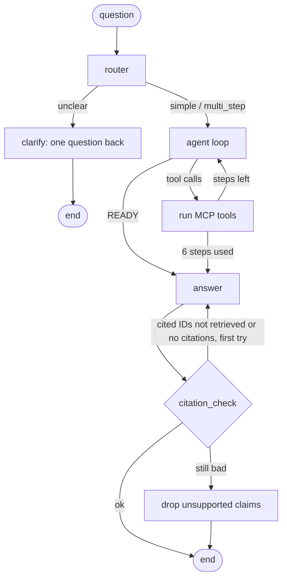

# atlandex-agent

A [LangGraph](https://langchain-ai.github.io/langgraph/) agent that answers questions about long-form video by calling the three tools of [`atlandex-mcp`](https://github.com/feynmanish/atlandex-mcp) (`find_videos`, `search_video`, `locate_quote`), plus an evaluation harness that measures task success, router accuracy and hallucination rate with an LLM judge. All models run through [OpenRouter](https://openrouter.ai), on free `:free` models by default.

**Status:** the agent and the eval code are finished and tested offline. The full evaluation has not been run yet, so there are no results below. See [Results](#results).

## How it works



1. **router** classifies the question as `simple`, `multi_step` or `unclear` (JSON output).
2. **clarify** returns one clarifying question for `unclear` and stops.
3. **agent loop**: the model sees the question and a size-capped digest of the evidence so far and either calls tools or says `READY`. At most 6 tool calls. Context is rebuilt each turn, not accumulated.
4. **answer** writes from the retrieved passages only, citing each claim as `[video_id@seconds]`.
5. **citation_check** verifies, without an LLM, that every cited ID was retrieved in this run. On failure the answer is retried once; if it still fails the unsupported sentences are dropped and that is recorded.

Passages carry no ID of their own, so the agent derives one: `video_id@start_sec` (`video_id@na<rank>` if the start time is unknown). The CLI maps IDs back to the tools' ready-made `citation` links.

## Setup

Requires Python 3.10+ and a working [`atlandex-mcp`](https://github.com/feynmanish/atlandex-mcp) install.

```bash
python -m venv .venv && source .venv/bin/activate   # Windows: .venv\Scripts\activate
pip install -e ".[dev]"
cp .env.example .env    # then fill it in
```

`.env` (never committed):

| Variable | Meaning |
|---|---|
| `OPENROUTER_API_KEY` | your OpenRouter key |
| `ATLANDEX_API_URL` | Atlandex backend `/api` base URL (the variable atlandex-mcp reads) |
| `ATLANDEX_MCP_COMMAND` | path to the installed `atlandex-mcp` entry point |
| `ALLOW_PAID` | default `false`; with false, any non-`:free` model raises an error |
| `BUDGET_USD` | default `0`; paid calls that could pass it are refused before they are sent |

Optional: `MODEL_SMALL`, `MODEL_LARGE`, `PAID_MODEL_SMALL`, `PAID_MODEL_LARGE`, `REQUESTS_PER_MINUTE` (20), `MAX_TOOL_STEPS` (6), `LLM_CACHE` (true).

Default models: small `poolside/laguna-xs-2.1:free`, large `nvidia/nemotron-3-super-120b-a12b:free` (also the judge). Why: [DECISIONS.md](DECISIONS.md).

## Run the agent

```bash
python -m atlandex_agent "What does Reiner Pope say about splitting compute between pre-training, RL and inference?" --model small
```

Prints the answer, the citation links, route, steps, latency, tokens and cost. `--model large`, `--no-cache` and `--json` are available. LLM responses are cached on disk under `.cache/`, keyed by model and prompt. Requests are throttled to 20 per minute and retried with backoff on 429/5xx.

## Run the eval

```bash
python -m eval.run --model both --subset 5 --include-review   # 5-query trial
python -m eval.run --model both                                # full run (verified records only)
python -m eval.sample_for_labels --n 30                        # writes eval/labels/to_label.csv
python -m eval.agreement                                       # judge vs your labels, after you fill human_label
```

- `eval/dataset.jsonl`: one record per query: `id`, `question`, `gold_segment_ids`, `expected_route`, `source` (`existing` | `new_candidate`), `needs_review`. Import your existing set with `python -m eval.import_existing PATH`.
- `needs_review: true` records are skipped unless `--include-review` is given, and never enter the headline numbers.
- A cited segment counts as gold if it matches exactly, if the gold entry is a bare video ID and the video matches, or if it is in the same video within `--gold-tolerance-sec` (default 60) of a timed gold entry.
- Each run writes `eval/results/<timestamp>/`: `records.jsonl` (full answers, tool calls, retrieved and cited IDs, tokens, cost; not committed), `summary.json` and `summary.md`.
- Metrics: task success (cites a gold segment), router accuracy, hallucination rate (share of answer sentences the judge marks unsupported by their cited text), steps, latency p50/p95, tokens and cost per query. The judge prompt is [`eval/judge_prompt.md`](eval/judge_prompt.md).

## Tests

```bash
pytest
```

All tests run offline with a fake LLM, a fake toolbox and a mock HTTP transport: router branches, the step limit, the paid-call lock, retry/throttle/cache/budget, citation check (pass, retry, drop), metrics and the agreement script. CI runs them on Python 3.10 and 3.13 without secrets.

## Results

Pending. No evaluation run has been made, so no numbers are reported here. The table will be filled only from a `summary.json` produced by `python -m eval.run`, and will cite that file.

| model | source | n | task success | router acc. | hallucination | steps | latency p50/p95 | cost |
|---|---|---|---|---|---|---|---|---|
| pending | | | | | | | | |

**Judge validation:** not yet labelled. `eval/labels/to_label.csv` has to be filled in by hand, then `python -m eval.agreement` reports agreement and Cohen's kappa.

## Limitations

- The eval set is small (22 existing queries plus 10 new ones), so differences of a few points are noise.
- The 10 new multi-step questions are unverified candidates (`needs_review: true`) and are reported separately from the headline numbers.
- The hallucination rate comes from an LLM judge whose agreement with human labels has not been measured yet. Until it is, treat the number as indicative.
- The "small" model is a ~3B-active MoE, not a 7-14B model; no free tool-calling model of that size exists on OpenRouter.
- Free models are rate-limited and intermittently unavailable; runs can take over an hour and some queries may fail and need re-running.
- Segment IDs are derived, and passage start times shift with the question wording or are missing, so gold matching is looser than an exact segment match (see above).
- Task success only requires citing one gold segment; it does not check that the answer is complete or correct beyond what the judge sees.
- `find_videos` matches index terms, not names; questions about a person who is not an indexed term cost the agent extra steps.
