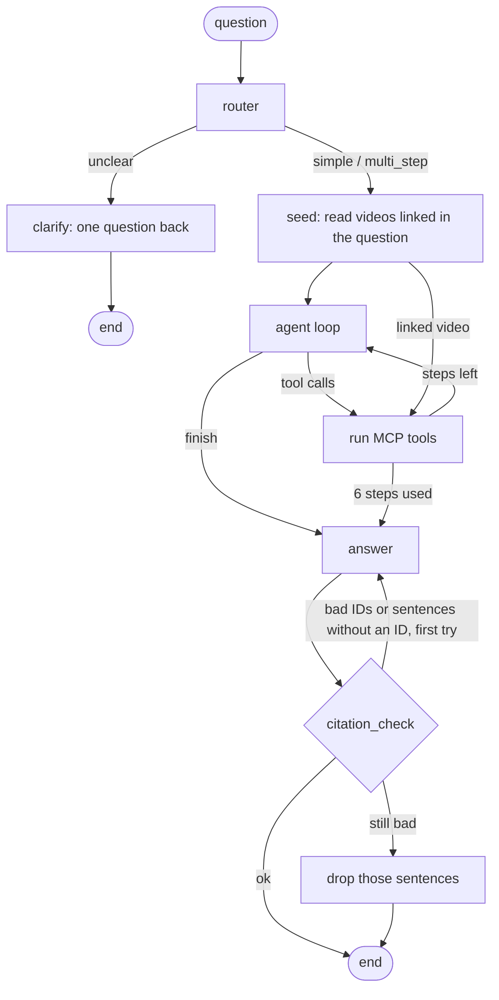
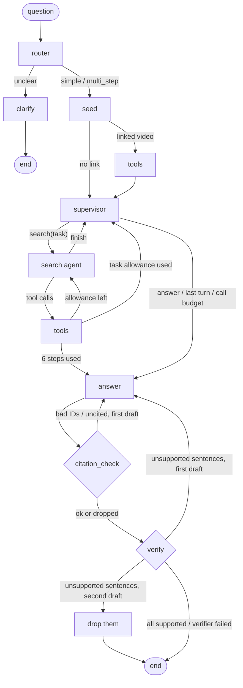

# atlandex-agent

A [LangGraph](https://langchain-ai.github.io/langgraph/) agent that answers questions about long-form video by calling the three tools of [`atlandex-mcp`](https://github.com/feynmanish/atlandex-mcp) (`find_videos`, `search_video`, `locate_quote`), plus an evaluation harness that measures video hit, segment hit (±60 s), router accuracy and hallucination rate with an LLM judge. All models run through [OpenRouter](https://openrouter.ai), on free `:free` models by default.

**Status:** the agent, the eval, three full free-model evaluations (the Phase 2 baseline, fixed v1 and the current fixed v2) and a single vs multi-agent comparison are done; see [Results](#results). The judge was validated against reference labels from Claude, not against human labels.

## Quick start

Nothing here needs an API key, a network connection or Langfuse:

```bash
git clone https://github.com/feynmanish/atlandex-agent && cd atlandex-agent
python -m venv .venv && source .venv/bin/activate   # Windows: .venv\Scripts\activate
pip install -e ".[dev]"
pytest -q                       # every test runs offline with a fake model and fake tools
python -m atlandex_agent --help
```

To ask a real question you need three things: an [OpenRouter](https://openrouter.ai) key (a free one is enough: the default models are `:free` models and paid models are refused unless you set `ALLOW_PAID=true`), the URL of a running Atlandex backend, and a working [`atlandex-mcp`](https://github.com/feynmanish/atlandex-mcp) install (the agent launches it over stdio). The backend is a separate service that this repo does not include, so without one the live commands below cannot run; the offline tests and the committed results in `eval/results/` still can be read and checked.

```bash
cp .env.example .env      # set OPENROUTER_API_KEY, ATLANDEX_API_URL and ATLANDEX_MCP_COMMAND
python -m atlandex_agent "What does Reiner Pope say about splitting compute between pre-training, RL and inference?" --model small
```

Leave the `LANGFUSE_*` lines in `.env` empty. Tracing is optional: without both Langfuse keys (or without `pip install -e ".[tracing]"`) it is off, `langfuse` is never imported, and nothing else changes. See [Observability](#observability).

## How it works



1. **router** classifies the question as `simple`, `multi_step` or `unclear` (JSON output).
2. **clarify** returns one clarifying question for `unclear` and stops.
3. **seed**: if the question links a YouTube video (all 22 existing eval questions do), that video (up to 3) is read first with `search_video` on its ID, so the agent does not spend steps finding it. It counts as a step.
4. **agent loop**: the model sees the question and a size-capped digest of the evidence so far and either calls tools or calls the no-argument `finish` tool (a bare `READY` still works). Agent turns are capped in output tokens (large model 1500, small 600; hidden reasoning counts against the cap) so a turn cannot turn into a draft answer. At most 6 tool calls in total. Context is rebuilt each turn, not accumulated.
5. **answer** writes from the retrieved passages only; every factual sentence ends with `[video_id@seconds]`. An empty answer is asked for again once with a larger budget; if it is still empty the run fails (it is never passed on to the citation check as an answer).
6. **citation_check** verifies, without an LLM, that every cited ID was retrieved in this run and that every factual sentence cites a segment (a sentence that only says the segments do not cover something, a heading or a fragment is not a claim). On failure the answer is retried once with the offending sentences named; if it still fails, those sentences are dropped and that is recorded (`dropped`, `dropped_uncited`). An answer with nothing left becomes the "no coverage" reply.

Passages carry no ID of their own, so the agent derives one: `video_id@start_sec` (`video_id@na<rank>` if the start time is unknown). The CLI maps IDs back to the tools' ready-made `citation` links.

## Multi-agent variant

`--arch multi` runs a second graph next to the one above (`--arch single`, the default and the reference). It adds a **supervisor** that hands the search agent one task at a time, and a **verification agent** that checks each answer sentence against the segments it cites. Everything else is shared code: the router, the seed, the agent loop (as the "search agent", with a `Task:` line in its user message and an unchanged system prompt), the tools, the answer step and the deterministic citation check. The single graph is pinned by golden transcripts (`tests/test_single_unchanged.py`), so adding the variant did not change it.



- **Bounds.** At most 3 supervisor turns (the last can only answer), the same 6 tool steps in total (3 per task), at most 2 answer drafts (the verifier's rewrite uses the same slot as the citation check's), at most 2 verification rounds, and at most **13 LLM calls per run for both architectures**. 13 is the most a single run can make, so the cap never changes `single`; in `multi`, once the calls left would not cover the answer, one rewrite and one verification, the graph goes to the answer (`call budget: forced answer` in the notes).
- **The verifier fails open.** An empty or unparseable verifier reply drops nothing. A sentence is dropped only when the verifier flags it twice (or once, if the citation check had already used the rewrite).
- **Same model, same caps.** Every role runs on the model under test. Supervisor and search turns use the agent-turn cap (large 1500, small 600), the verifier the 1500-token default (`VERIFY_MAX_TOKENS` to change it).
- Settings (all optional, see `.env.example`): `AGENT_ARCH`, `SEARCH_STEPS_PER_TASK`, `MAX_SUPERVISOR_TURNS`, `VERIFY_MAX_TOKENS`, `MAX_LLM_CALLS_PER_RUN`.
- The eval compares the two on the same queries with `python -m eval.run --arch both` and `python -m eval.compare --baseline R:single --fixed R:multi`; the design, the guards against a gain that only comes from deleting sentences, and the pre-registered rules are in [PLAN.md](PLAN.md) and [DECISIONS.md](DECISIONS.md#multi-agent-comparison-2026-10-13).

## Setup

Requires Python 3.10+ and a working [`atlandex-mcp`](https://github.com/feynmanish/atlandex-mcp) install.

```bash
python -m venv .venv && source .venv/bin/activate   # Windows: .venv\Scripts\activate
pip install -e ".[dev]"
cp .env.example .env    # then fill it in
```

`.env` (never committed):

| Variable | Meaning |
|---|---|
| `OPENROUTER_API_KEY` | your OpenRouter key |
| `ATLANDEX_API_URL` | Atlandex backend `/api` base URL (the variable atlandex-mcp reads) |
| `ATLANDEX_MCP_COMMAND` | path to the installed `atlandex-mcp` entry point |
| `ALLOW_PAID` | default `false`; with false, any non-`:free` model raises an error |
| `BUDGET_USD` | default `0`; paid calls that could pass it are refused before they are sent |

Optional: `MODEL_SMALL`, `MODEL_LARGE`, `PAID_MODEL_SMALL`, `PAID_MODEL_LARGE`, `REQUESTS_PER_MINUTE` (20), `MAX_TOOL_STEPS` (6), `LLM_CACHE` (true), `AGENT_MAX_TOKENS_LARGE` (1500), `AGENT_MAX_TOKENS_SMALL` (600), `AGENT_MAX_TOKENS` (overrides both; unset), `ANSWER_RETRY_MAX_TOKENS` (4000).

Default models: small `poolside/laguna-xs-2.1:free`, large `nvidia/nemotron-3-super-120b-a12b:free` (also the judge). Why: [DECISIONS.md](DECISIONS.md).

## Run the agent

```bash
python -m atlandex_agent "What does Reiner Pope say about splitting compute between pre-training, RL and inference?" --model small
```

Prints the answer, the citation links, route, steps, latency, tokens and cost. `--model large`, `--no-cache` and `--json` are available. LLM responses are cached on disk under `.cache/`, keyed by model and prompt. Requests are throttled to 20 per minute and retried with backoff on 429/5xx.

## Run the eval

```bash
python -m eval.run --model both --subset 5 --include-review    # 5-query trial
python -m eval.run --model both --include-review               # full run: 22 existing + 10 new candidates, both models
python -m eval.run --resume eval/results/<run> --model both --include-review   # re-run only the runs that errored
python -m eval.summarize eval/results/<run>                    # rebuild summary.json/md from records.jsonl
python -m eval.rejudge --results eval/results/<run> --only-unjudged   # re-judge only answers with unjudged sentences (sidecar + report)
python -m eval.compare --baseline eval/results/<old> --fixed eval/results/<new>   # per-query before/after (comparison.md)
python -m eval.run --model large --arch both --no-cache          # single and multi on the same queries, alternating order, one judge
python -m eval.compare --baseline eval/results/<run>:single --fixed eval/results/<run>:multi --name arch_comparison
python -m eval.trajectory --run base=<dir> --run v1=<dir> --run v2=<dir> --caps base=1500:1500 --out <dir>   # follow queries through 3 runs, with cap hits and drafts
python -m eval.sample_for_labels --n 30 --stratify             # eval/labels/to_label.csv (no verdicts) + judge_verdicts.csv
python -m eval.agreement                                       # main judge vs the reference labels
python -m eval.rejudge --results eval/results/<run> --judge-model <id> --name <short> --labelled-only
python -m eval.agreement --alt-judge eval/results/<run>/judge_<short>.jsonl
```

- `eval/dataset.jsonl`, one record per query: `id`, `question`, `gold_video_ids`, `gold_segments` (`{video, start, end}` in seconds), `gold_basis`, `expected_route`, `source` (`existing` | `new_candidate`), `needs_review`, `verified_by`.
- **`existing`**: the 22 hand-labelled retrieval queries from the project's own earlier retrieval eval (3 videos). Their gold labels are chunk indices, mapped to time spans with `eval/chunk_map.py` (56 observations, no ordering violations; see [DECISIONS.md](DECISIONS.md)). **`new_candidate`**: 10 multi-step questions drafted for this repo; 7 pass a check by Claude (`verified_by: claude`), 3 do not and stay `needs_review: true`.
- Two hit measures, kept separate and never merged: **video hit** (the answer cites a segment of a gold video) and **segment hit (±60 s)** (it cites a segment whose start lies inside a gold span, widened by 60 s on each side). Video hit is not task success: it only says the right video was found. A segment without a start time can never be a segment hit.
- Rates are over completed runs. A run that failed because the free model stayed unavailable after 6 retries shows up in *runs ok/total* and is not counted as a miss.
- `needs_review: true` records run only with `--include-review` and are always listed apart from the headline numbers.
- Each run writes `eval/results/<timestamp>/`: `records.jsonl` (full answers, tool calls, retrieved and cited IDs, tokens, cost; not committed), `summary.json` and `summary.md`.
- Other metrics: router accuracy, hallucination rate (share of *judged* answer sentences the judge marks unsupported by their cited text), the **unjudged share** (sentences and answers the judge gave no verdict for), steps, latency p50/p95, tokens and cost. The judge prompt is [`eval/judge_prompt.md`](eval/judge_prompt.md).
- **Unjudged is not clean.** A sentence the judge returned no usable verdict for is `unjudged`. The hallucination rate is computed on judged sentences only, never treats an unjudged sentence as supported, and is `n/a` (not 0%) when nothing was judged. Next to it the summary prints the unjudged share (sentences and answers) and an upper bound that counts every unjudged sentence as unsupported; above 10% unjudged sentences it adds a coverage warning. Read the rate together with that share.

## Observability

Optional [Langfuse](https://langfuse.com) tracing. Install the extra and set `LANGFUSE_PUBLIC_KEY`, `LANGFUSE_SECRET_KEY` and `LANGFUSE_HOST` in `.env`:

```bash
pip install -e ".[tracing]"
```

Without the keys (or without the extra) nothing changes: tracing is off, `langfuse` is never imported, and the tests and CI need neither. `--no-trace` (agent and eval) or `LANGFUSE_TRACING=false` turns it off even when keys are set. The CLI prints the trace URL.

**What a trace shows.** One agent run is one trace named `atlandex-agent`. Its input is the question and its output is the answer with route, cited and retrieved IDs, citation-check result, notes, latency and token/cost totals. Below it is the LangGraph run with one span per node: `router` (its output is the route and reason), `agent` and `tools` (once per loop turn), `answer`, and `citation_check` (retry or dropped claims). Inside the nodes are one `llm:<role>` generation per model call (model, messages, reply or tool calls, input/output tokens, cost, and whether it was a cache hit or a retry) and one tool span per MCP call (arguments and result; failed calls are marked as errors). Cost is `0` on free models.

**Eval runs.** Each trace is tagged `run:<results dir name>`, `model:<model id>` and `query:<record id>`, and the run id is also the Langfuse session, so one eval run is one session. After the judge has run, these scores are attached to the trace: `hallucination_rate` (share of judged sentences marked unsupported; the comment lists them), `task_success` (cites a gold segment, only for records with gold segments), `video_hit` (cites a gold video), and `router_correct`, plus `unjudged_share` (share of the answer's sentences the judge gave no verdict for). When the judge gave no verdict at all there is no `hallucination_rate` score: an unjudged answer is never scored as clean. The judge's own calls are not traced.

Prompts and retrieved passages are sent to Langfuse as trace content, and tool results longer than 8000 characters are cut in the trace.

## Tests

```bash
pytest
```

All tests run offline with a fake LLM, a fake toolbox and a mock HTTP transport: router branches, the step limit, the paid-call lock, retry/throttle/cache/budget, citation check (pass, retry, drop), metrics and the agreement script. CI runs them on Python 3.10 and 3.13 without secrets.

## Results

Three runs of the same 29 verified queries, never mixed in one table: **fixed v2** (current), **fixed v1** (an intermediate step, kept for the record) and the **Phase 2 baseline** from before any fix. They are linked only by the paired before/after table below. Free models only, paid spend $0.00, tracing on. The judge is `nvidia/nemotron-3-super-120b-a12b:free`. Treat all of it as a small-sample snapshot, not a ranking: 22 and 7 queries per model.

### Single vs multi-agent (2026-10-13/14)

Runs [`20261013-174814`](eval/results/20261013-174814/summary.md) (large) and [`20261014-074127`](eval/results/20261014-074127/summary.md) (small), commit `e531ba3`, `python -m eval.run --arch both --no-cache`: the two graphs on the same queries, back to back, alternating order, one throttle, the same judge (nemotron), the same models and token caps, at most 13 LLM calls per run for both. Paired comparisons: `arch_comparison.md` in each folder. The rules for what counts as a result were committed before the runs ([DECISIONS.md](DECISIONS.md#multi-agent-comparison-2026-10-13)).

| model | paired queries | | segment hit (±60 s) | hallucination, main judge (judged sentences) | LLM calls mean / max | latency p50 / p95 (s) | tokens in / out |
|---|---|---|---|---|---|---|---|
| large | 29 of 29 | single | 22/29 (76%) | 21% (52) | 4.3 / 9 | 64 / 138 | 6161 / 1982 |
| large | 29 of 29 | multi | 23/29 (79%) | 10% (50) | 7.4 / 13 | 88 / 199 | 9296 / 3466 |
| small | 22 of 29 | single | 19/22 (86%) | 20% (55) | 4.4 / 9 | 91 / 267 | 6332 / 1236 |
| small | 22 of 29 | multi | 11/22 (50%) | 27% (59) | 6.5 / 11 | 133 / 294 | 8727 / 2229 |

- **Large:** no measurable difference in segment hit (1 vs 2 discordant queries, p = 1.0). The hallucination rate falls from 21% to 10% on the main judge, but the 95% interval over queries (−28 to +4 points) includes 0, so by the registered rule that is **no measurable difference**. A second judge from another family (`cohere/north-mini-code:free`, not the registered primary) sees 31% → 4% (−27 points, [−42, −13]). The deletion guards pass (2.3 final sentences per answer in both arms, 1 sentence dropped by the verifier). The multi arm costs 72% more LLM calls and 37% more median latency, and 7 of its 29 runs hit the call cap and were sent to the answer early.
- **Small:** 7 of 58 query-runs could not be completed (upstream HTTP 429 for long stretches, six resume passes), so 22 queries are paired. Segment hit is lower for multi (8 vs 0 discordant, p = 0.008), but in 7 of those 8 queries the multi answer cites a passage with no start time (`@na`), which can never be a segment hit, and the same first search returned timed passages in the single arm; on the 8 queries where neither arm retrieved an untimed passage the two are level (5 vs 4). That is the backend's null-`start_sec` behaviour ([DECISIONS.md](DECISIONS.md)), so this result cannot be attributed to the architecture. Hallucination: 20% vs 27%, no measurable difference. The small model's verifier flagged nothing in 21 calls, 4 of them empty or cut off.
- **Conditions moved:** the fresh single arm of the large model hit 22/29 against fixed v2's 25/29 (the registered band was ±2): the router, which is not cached, answered two queries with a clarifying question in the single arm and not in the multi arm.
- **Not shown:** that `multi` is better, at equal cost or otherwise. The sample can detect only large effects, nothing was ablated (supervisor and verifier together), and the verifier is the judge's model in the large run.

### Fixed v2 (current)

Run [`eval/results/20261012-fixed-v2`](eval/results/20261012-fixed-v2/summary.md). Fixed v1 plus: the agent-turn token cap is per model (large 1500, small 600, from config), an empty answer is asked again once with a 4000-token budget, and an answer that is still empty fails the run. **How the run was made:** the large model's 29 queries were re-run (`--no-cache`, budget guard on; 29/29 completed, 0 failed); the small model's half is fixed v1's 29 records, unchanged. That is valid because none of the small model's 29 answers was empty (so the retry could not have fired) and its cap stayed 600, so the code path it ran through is the same. The small rows are therefore identical in v1 and v2 by construction.

**Existing 22 queries**

| model | runs ok/total | video hit | segment hit (±60 s) | router acc. | hallucination (judged sentences) | unjudged sentences | steps (mean) | latency p50 / p95 (s) | tokens in / out (agent, mean) |
|---|---|---|---|---|---|---|---|---|---|
| nemotron-3-super-120b (large) | 22/22 | 91% | 91% | 91% | 13% (45) | 0 of 45 | 1.4 | 38.9 / 101.8 | 4,850 / 1,866 |
| laguna-xs-2.1 (small), = v1 | 22/22 | 82% | 77% | 82% | 23% (62) | 0 of 62 | 1.9 | 83.4 / 193.2 | 5,326 / 1,022 |

**New multi-step questions, only 7 queries (verified by Claude)**

| model | runs ok/total | video hit | segment hit (±60 s) | router acc. | hallucination (judged sentences) | unjudged sentences | steps (mean) | latency p50 / p95 (s) | tokens in / out (agent, mean) |
|---|---|---|---|---|---|---|---|---|---|
| nemotron-3-super-120b (large) | 7/7 | 71% | 71% | 100% | 21% (19) | 0 of 19 | 5.3 | 107.9 / 190.8 | 16,044 / 4,826 |
| laguna-xs-2.1 (small), = v1 | 7/7 | 86% | 86% | 86% | 38% (21) | 0 of 21 | 5.7 | 167.4 / 264.5 | 14,399 / 1,960 |

**How to read the hallucination numbers: they are an upper bound, from an imperfect judge.** The rate is the share of judged answer sentences that an LLM judge (`nemotron-3-super-120b:free`) marks as not supported by the passage they cite. It has not been checked by humans. Against reference labels from a stronger model (Claude, not a human) on 30 stratified sentences, the judge agreed 80% of the time (**Cohen's kappa 0.60**), caught all 9 sentences the reference marked unsupported (**high recall**) and raised 6 false alarms (it flagged 15). It therefore over-flags, so read each rate as an **upper bound** on the true unsupported share, not as an estimate of it. Limits of that check: 30 sentences with 9 positives is a small sample, so the high recall is itself uncertain; the reference labeller is an LLM that also wrote the rubric; and the sample was drawn before the judge fix (which changed its token budget and retry, not its prompt). Details: [Judge validation](#judge-validation). Unjudged sentences are 0 in the fixed runs, so these rates have no coverage gap.

**Only 7 queries in the candidates set.** One query is 14 points, the 7 questions were drafted for this repo and checked by Claude rather than a human, and their gold comes from the same retrieval the agent uses. Treat the candidate rows as an illustration, not as a result.

Hit rates are over 22 or 7 queries, so one query is 4.5 or 14 points. Router accuracy moved from 86% (v1) to 91% for the large model on the existing set without a router change: the run is uncached, so router replies vary between runs, and that is one query.

- **Large-model agent turns (71 in 29 runs):** 48 tool calls, 21 `finish` calls, **2 still cut off at the 1500 cap** without a tool call (`nc02`, `nc09`, both late in multi-step runs; the agent treats them as done and notes it), and **0 drafts** (no turn without a tool call wrote more than 200 characters). In v1, with the 600 cap, 17 of 60 turns were cut off.
- **Empty answers:** 5 large-model runs (`ex01`, `ex10`, `ex14`, `nc03`, `nc05`) returned an empty first answer; the larger-budget retry rescued all five. No run ended with an empty answer, so none failed.
- **What it costs:** the reasoning that the 600 cap cut off is now paid for. The large model's `finish` turns alone take a median of 545 completion tokens (tool-call turns 320), so p50 latency is 52 s per query against 34 s in v1 and 38 s in the baseline, and output tokens are up by about half against v1. Free-tier load also varies between runs, so read the latency as indicative.
- **Uncited sentences (all 58 runs, same as v1 for the small model):** 11 flagged out of 158 final sentences, 1 dropped after the retry. The large model's 29 runs flagged 1 and dropped none.

### Before / after: baseline → fixed v1 → fixed v2 (same queries, paired)

Only query-runs completed in all three runs are used (large 29, small 24 of 29). Latency is wall-clock seconds per query-run; tokens are the agent's own calls (the judge is excluded). The baseline's hallucination rate uses the re-judged verdicts, so all three come from the same judge code. Hit rates pool the existing and verified-candidate queries. *Cap hits* = agent turns that used their whole token cap (cap in brackets); *drafts* = agent turns with no tool call and more than 200 characters of visible text instead of calling `finish` (only recorded from v2 on). The hallucination column has the judge limits described under Fixed v2 (kappa 0.60, high recall, so an upper bound); the candidates are only 7 queries. Per-query rows: [`trajectory.md`](eval/results/20261012-fixed-v2/trajectory.md) (rebuild with `python -m eval.trajectory`, see "Run the eval").

| agent model | run | steps | latency p50 / p95 (s) | tokens in / out | hallucination (judged sent.) | segment / video hit | agent turns | cap hits | drafts instead of `finish` |
|---|---|---|---|---|---|---|---|---|---|
| nemotron (large), 29 | baseline | 2.3 | 37.6 / 113.4 | 7,308 / 2,376 | 42% (50) | 76% / 79% | 89 | 5 (cap 1500) | n/a |
| | fixed v1 | 1.8 | 33.8 / 81.4 | 6,014 / 1,681 | 20% (46) | 66% / 76% | 60 | **17** (cap 600) | n/a |
| | **fixed v2** | 2.3 | 52.1 / 159.6 | 7,552 / 2,581 | **16%** (64) | **86% / 86%** | 71 | **2** (cap 1500) | **0 of 71** |
| laguna (small), 24 | baseline | 2.0 | 54.2 / 162.9 | 5,448 / 1,018 | 40% (80) | 75% / 79% | 67 | 0 (cap 1500) | n/a |
| | fixed v1 = v2 | 2.2 | 85.1 / 196.4 | 6,298 / 1,191 | 22% (68) | 79% / 83% | 52 | 3 (cap 600) | n/a |

For the large model, v1's lower steps, tokens and latency were partly an artefact: the cap ended 17 agent turns early, and the queries that lost their tool call lost their hits too (segment hit 76% → 66%). v2 gives that reasoning room again, so steps return to baseline level, latency and tokens go above it, and the hallucination rate (42% → 16%) and segment hit (76% → 86%) are the best of the three. The old "reply READY" turn that wrote a draft answer has disappeared as a problem: 0 drafts in 71 turns.

### Fixed v1 (intermediate step)

**Superseded for the large model by v2 above.** Kept because it shows what the 600-token cap did to a reasoning model, and the small model's v1 records are also its v2 records.


Run [`eval/results/20261012-062749`](eval/results/20261012-062749/summary.md) (`python -m eval.run --model both --no-cache`, then four `--resume` passes for runs the free small model dropped on upstream HTTP 429s; all 58 query-runs completed). Code: everything in [DECISIONS.md](DECISIONS.md) "Plan: three fixes" plus fix 4: judge budget and batched retry, uncited sentences checked and dropped, linked videos read first, `finish` tool with a 600-token cap on agent turns.

**Existing 22 queries**

| model | runs ok/total | video hit | segment hit (±60 s) | router acc. | hallucination (judged sentences) | unjudged sentences | steps (mean) | latency p50 / p95 (s) | tokens in / out (agent, mean) |
|---|---|---|---|---|---|---|---|---|---|
| nemotron-3-super-120b (large) | 22/22 | 82% | 73% | 86% | 15% (34) | 0 of 34 | 1.2 | 26.4 / 78.0 | 3,998 / 1,374 |
| laguna-xs-2.1 (small) | 22/22 | 82% | 77% | 82% | 23% (62) | 0 of 62 | 1.9 | 83.4 / 193.2 | 5,326 / 1,022 |

**New multi-step questions, only 7 queries (verified by Claude)**

| model | runs ok/total | video hit | segment hit (±60 s) | router acc. | hallucination (judged sentences) | unjudged sentences | steps (mean) | latency p50 / p95 (s) | tokens in / out (agent, mean) |
|---|---|---|---|---|---|---|---|---|---|
| nemotron-3-super-120b (large) | 7/7 | 57% | 43% | 100% | 33% (12) | 0 of 12 | 3.9 | 58.8 / 115.2 | 12,349 / 2,645 |
| laguna-xs-2.1 (small) | 7/7 | 86% | 86% | 86% | 38% (21) | 0 of 21 | 5.7 | 167.4 / 264.5 | 14,399 / 1,960 |

Task success here means the two hit rates above, kept apart as before (video hit: cites a gold video; segment hit: cites a segment inside a gold span ±60 s). Unjudged sentences are 0 everywhere, so the hallucination rate and its upper bound are the same number. Hit rates are over 22 or 7 queries, so one query is 4.5 or 14 points.

- **Uncited sentences:** across the 58 runs the answer check flagged 11 factual sentences without an ID (153 final sentences in total) and dropped **1** after the retry. Replaying the old Phase 2 answers through the same check had flagged 22 of 139 sentences (16%), so the new answer prompt did most of the work and the drop is the safety net.
- **The 600-token cap on agent turns hurts the large model.** An agent turn hit the cap in 19 of 58 runs (large 16, small 3). The large model is a reasoning model whose hidden thinking counts against the cap, so a turn can be cut off before it emits a tool call; the agent then treats it as done (noted in `notes`). This is the main reason the large model's existing-set segment hit fell from 82% to 73%: `ex01`, `ex05`, `ex09` lost their hit, and the multi-step `nc03` went from 6 steps to 1. A diagnostic re-run of those queries with the cap at 1500 (large model only, 6 queries, not part of any table above) recovered `ex01`, `ex05` and `ex09`. See DECISIONS.md. Fixed in v2 by making the cap per model.
- **Empty answers:** 2 large-model answers are empty because the answer step ran out of its own 1500-token budget on hidden reasoning (the Phase 2 baseline had 2 such answer calls as well). An empty answer currently passes the citation check, counts as no hit, and is not retried. Not fixed here. Fixed in v2: one retry with a bigger budget, and a still-empty answer fails the run.
- **The small model's latency is mostly provider noise.** 61–64% of its LLM calls needed retries after HTTP 429 in both runs, and about 85% of its LLM time was spent in those retried calls, so its latency rises and falls with the free tier's load rather than with the code.

### Baseline vs fixed v1 (paired)

Only query-runs completed in both runs are compared (large 29, small 24 of 29). Latency is wall-clock seconds per query-run and tokens are the agent's own calls (the judge is excluded). The baseline's hallucination rate here uses the re-judged verdicts (judge fix applied to the Phase 2 records), so both sides come from the same judge code. Per-query rows: [`comparison.md`](eval/results/20261012-062749/comparison.md) (rebuild with `python -m eval.compare --baseline eval/results/20261011-125600 --fixed eval/results/20261012-062749`).

| agent model | paired runs | | steps (mean) | latency p50 / p95 (s) | tokens in / out | hallucination (judged sentences) | unjudged sentences |
|---|---|---|---|---|---|---|---|
| nemotron (large) | 29 | before | 2.3 | 37.6 / 113.4 | 7,308 / 2,376 | 42% (50) | 0 |
| | | after | 1.8 | 33.8 / 81.4 | 6,014 / 1,681 | 20% (46) | 0 |
| laguna (small) | 24 | before | 2.0 | 54.2 / 162.9 | 5,448 / 1,018 | 40% (80) | 0 |
| | | after | 2.2 | 85.1 / 196.4 | 6,298 / 1,191 | 22% (68) | 0 |

Large: fewer steps, less latency and fewer tokens (the linked video is read first, and no more draft answers in the "done" turn), and the hallucination rate halves. Small: steps and tokens go up slightly (the first search result is now in every later prompt) and the latency change is dominated by the 429 retries described above, so it says nothing about the code. The hallucination drop for both models comes mostly from uncited sentences no longer appearing. Over all completed runs, 53 of 130 judged baseline sentences were unsupported and 25 of those cited nothing; in the fixed run 31 of 129 were unsupported and 8 cited nothing. Among sentences that do cite, the unsupported share also fell (29% to 19%), which I cannot attribute to a cause.

### Phase 2 baseline (before the fixes)

**This is the baseline run, from before the judge fix, the uncited-sentence check, the linked-video step and the finish tool. Do not compare it with the fixed-version tables above except through the paired table.**

Source: [`eval/results/20261011-125600/summary.json`](eval/results/20261011-125600/summary.json) (rendered in `summary.md`), one run, free models only, paid spend $0.00. The agent was run twice per query, once with each model; the judge is `nvidia/nemotron-3-super-120b-a12b:free`. Hit rates are over completed runs (*ok/total* shows how many runs finished). Read these as a small-sample snapshot, not a ranking: 22 and 7 queries.

**Existing 22 queries** (hand-labelled retrieval probes, each naming its video, so video hit is close to guaranteed by construction; segment hit is the informative number)

| model | runs ok/total | video hit | segment hit (±60 s) | router acc. | hallucination (judge, upper bound) | steps (mean) | latency p50 / p95 (s) |
|---|---|---|---|---|---|---|---|
| nemotron-3-super-120b (large) | 22/22 | 82% | 82% | 86% | 41% (27 judged sentences) | 1.5 | 33.5 / 62.9 |
| laguna-xs-2.1 (small) | 22/22 | 82% | 77% | 82% | 39% (57 judged sentences) | 1.7 | 53.4 / 132.9 |

**New multi-step questions, only 7 queries (verified by Claude)** (comparison and find-then-follow-up questions; segment gold is single start times of passages Claude judged relevant)

| model | runs ok/total | video hit | segment hit (±60 s) | router acc. | hallucination (judge, upper bound) | steps (mean) | latency p50 / p95 (s) |
|---|---|---|---|---|---|---|---|
| nemotron-3-super-120b (large) | 7/7 | 71% | 57% | 100% | 78% (9 judged sentences) | 5.0 | 89.6 / 141.8 |
| laguna-xs-2.1 (small) | **2/7** | 50% (n=2) | 50% (n=2) | 100% | 40% (10 judged sentences) | 6.0 | 123.1 / 163.6 |

The small model's 5 missing runs are upstream HTTP 429 outages (it was retried in three passes; I stopped to keep the daily free quota), so its multi-step row rests on 2 queries and says almost nothing. The 3 candidates that failed Claude's check (`nc01`, `nc07`, `nc08`) ran too but are not in the headline: large 3/3 completed, small 1/3.

Cost: $0.00 (free models). Mean tokens per completed run, existing set: large 5,129 in / 1,785 out, small 4,940 in / 970 out.

How to read the hallucination column: the judge over-flags (see below), 24 of the 44 sentences it flagged cited nothing at all, and 27 sentences got no verdict and are excluded (see the re-judge below). In the 30-row validation sample (Cohen's kappa 0.60, recall 9 of 9) the judge's flags were right 9 times out of 15, so the true rate under the reference rubric is probably well below these numbers. Treat them as an upper bound.

**Re-judging the unjudged sentences.** The 27 (30 with the candidates the headline leaves out) were unjudged because the free judge ran out of its 1500-token budget. The judge now gets 4000 tokens, keeps the verdicts of a cut-off reply and re-asks only for the missing sentences (`python -m eval.rejudge --results eval/results/20261011-125600 --only-unjudged`). On this run it re-judged 7 answers and left 0 sentences unjudged. The table above is the original, as published; the re-judged numbers are in [`rejudge_report.json`](eval/results/20261011-125600/rejudge_report.json):

| model | source | hallucination, judged only (upper bound), original | after re-judge | unjudged sentences, original | after |
|---|---|---|---|---|---|
| nemotron-3-super-120b (large) | existing | 41% (54%), 27 judged | 40% (40%), 35 judged | 8 of 35 | 0 |
| laguna-xs-2.1 (small) | existing | 39% (50%), 57 judged | 40% (40%), 70 judged | 13 of 70 | 0 |
| nemotron-3-super-120b (large) | verified candidates | 78% (87%), 9 judged | 47% (47%), 15 judged | 6 of 15 | 0 |
| laguna-xs-2.1 (small) | verified candidates | 40% (40%), 10 judged | 40% (40%), 10 judged | 0 of 10 | 0 |

The upper bound counts an unjudged sentence as unsupported; once every sentence has a verdict, rate and upper bound are the same number.

### Judge validation

**Validated against reference labels from a stronger model (Claude), not human labels.** Claude (Sonnet 5.5) labelled 30 judged answer sentences against the rubric in `eval/judge_prompt.md` before looking at any judge verdict; the sample is stratified (half from sentences the judge flagged, half from the rest), so agreement is not the judge's accuracy on the natural mix. Labels: [`eval/labels/to_label.csv`](eval/labels/to_label.csv); verdicts: `judge_verdicts.csv`.

| judge | rows | agreement with reference | Cohen's kappa | notes |
|---|---|---|---|---|
| main: nemotron-3-super-120b:free | 30 | 80.0% | 0.60 | caught 9 of 9 reference-unsupported sentences, 6 false alarms (flagged 15, reference says 9) |
| alternative: cohere/north-mini-code:free | 25 | 76.0% | 0.53 | answers behind 5 rows were not re-judged |
| main vs alternative | 55 sentences | 92.7% | 0.85 | the 22 re-judged answers only |

So the main judge is usable but strict: it rarely misses an unsupported claim and often flags a supported one.

## Limitations

- The eval set is small (22 existing queries, 7 verified new ones), so differences of a few points are noise. The small model has only 2 completed multi-step runs.
- The existing set's gold labels are chunk indices, mapped to time spans by inference (consistent across 56 observations, but not read from the database). Some spans are narrow, so segment hit can under-count there. Its questions name the video, so it measures citing the right passage, not finding the video.
- The 7 verified candidates were checked by Claude, not by a human, and their segment gold comes from the same retrieval the agent uses. Three candidates failed that check and are excluded from the headline.
- The judge's agreement was measured against Claude's labels on 30 stratified rows. Both are LLMs and the labeller wrote the rubric, so this is a consistency check, not human ground truth.
- The "small" model is a ~3B-active MoE, not a 7-14B model; no free tool-calling model of that size exists on OpenRouter. Free models are rate-limited and intermittently down: a full run took about 1.5 hours and needed several re-run passes, and some runs still failed.
- Passage start times move with the question wording, and a minority of passages come back with no start time (0.5% to 7% in three samples, higher in an earlier ad-hoc one), which can never be a segment hit.
- `find_videos` matches index terms, not names, so questions about a person who is not an indexed term cost the agent steps (9 completed runs used all 6). These are atlandex-mcp findings, not fixed here; see [DECISIONS.md](DECISIONS.md).
- The Langfuse `task_success` score (added with the tracing) is the segment-hit measure above; it is not video hit.
- The agent-turn token cap is per model (large 1500, small 600) because hidden reasoning tokens count against it; with 1500, 2 of 71 large-model turns were still cut off before a tool call. The large model is slower and uses more tokens than with the 600 cap (see Results): the reasoning that was cut off is now paid for.
- The small model's fixed-v2 records are its fixed-v1 records (see Results for why that is valid); only the large model was re-run.
- An empty answer is retried once with a 4000-token budget and fails the run if still empty; 5 of 29 large-model runs needed the retry, so the default 1500-token answer budget is tight for the large model.
- The uncited-claim check is a heuristic (see DECISIONS.md): it can miss an uncited claim phrased like a "not covered" statement, and it treats a bare ID without brackets as uncited.

## License

The code is under the [MIT License](LICENSE). The data is not covered by it: `eval/existing/`, `eval/labels/` and `eval/results/` quote short excerpts of the automatic transcripts of third-party YouTube videos (the queries, the retrieved passages and the model answers that cite them), which belong to the videos' creators and are included only to make the evaluation reproducible and checkable.
